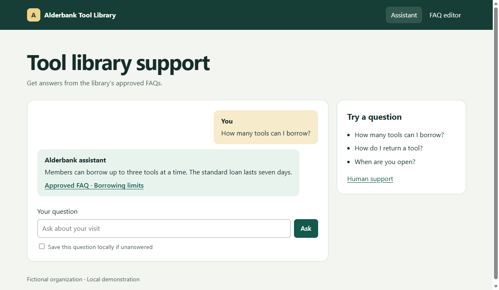

# Knowledge-Grounded Support Assistant

A local chatbot for **Alderbank Tool Library**, a fictional organization. The assistant matches a visitor’s question to approved FAQs, returns the stored answer with a source link, and offers a staffed-desk route when the match is absent or ambiguous.



## Run locally

Use Python 3.10 or later. The application, tests and evaluation use the Python standard library.

```sh
python -X utf8 -B app.py
```

Open `http://127.0.0.1:8765`. Use **FAQ editor** in the navigation to add a draft, edit an answer, approve it or unpublish it. A first launch seeds an SQLite database at `instance/support.sqlite3`. Pass `--db path/to/demo.sqlite3` to use a different database and `--port 8766` to choose a different local port. Stop the app with Ctrl+C.

| Implemented | How to try it |
| --- | --- |
| Approved answer and source | Ask “How many tools can I borrow?” and open the linked FAQ. |
| Conservative fallback | Ask an unknown question or combine two topics. The assistant offers human support without choosing an answer. |
| FAQ authoring and approval | Add a draft in the editor. Approval makes it retrievable. Editing returns it to draft. |
| Unanswered-question queue | Opt in on an unanswered request. View or clear the locally saved queue in the editor. |
| Human handoff | Follow **Human support** to fictional staffed-desk instructions. |

[Architecture](docs/ARCHITECTURE.md) · [Example conversations](docs/EXAMPLES.md) · [90-second demonstration](docs/DEMO.md) · [Contributions](CONTRIBUTIONS.md)

## Evaluate

```sh
python -X utf8 -B -m unittest -v
python -X utf8 -B evaluate.py
```

The behavioral evaluation uses a fresh seeded database and checks 16 fixed synthetic questions against the expected route and source topic. The test suite also exercises approval transitions, the queue and loopback HTTP behavior. Hosted GitHub Actions is configured for Windows and Linux with Python 3.10 and 3.14 and remains unverified.

## Limitations and proposed integrations

- Retrieval uses curated, whole-word aliases. Unexpected wording can miss an answer, and a phrase in an unrelated context can retrieve a plausible but irrelevant FAQ. Approval records editorial state and cannot verify factual accuracy.
- The demo uses checked-in text, English FAQ aliases and one question at a time. It has no live model, embeddings, translation or conversation history.
- The FAQ editor is a local workstation for a trusted operator. It has no user accounts or role separation. The escalation page neither contacts a real team nor files a ticket. Keep the server on loopback and use synthetic questions only. Opt-in saves raw text locally without redaction.
- Authentication, audited roles, a real support channel and a separate held-out evaluation are possible future integrations. This sample makes no production-readiness claim.

## Reuse

This portfolio sample carries no outbound open-source license grant.
