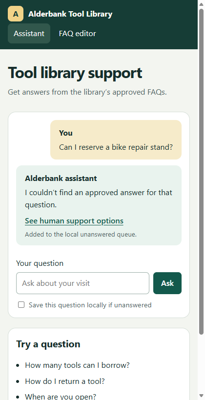
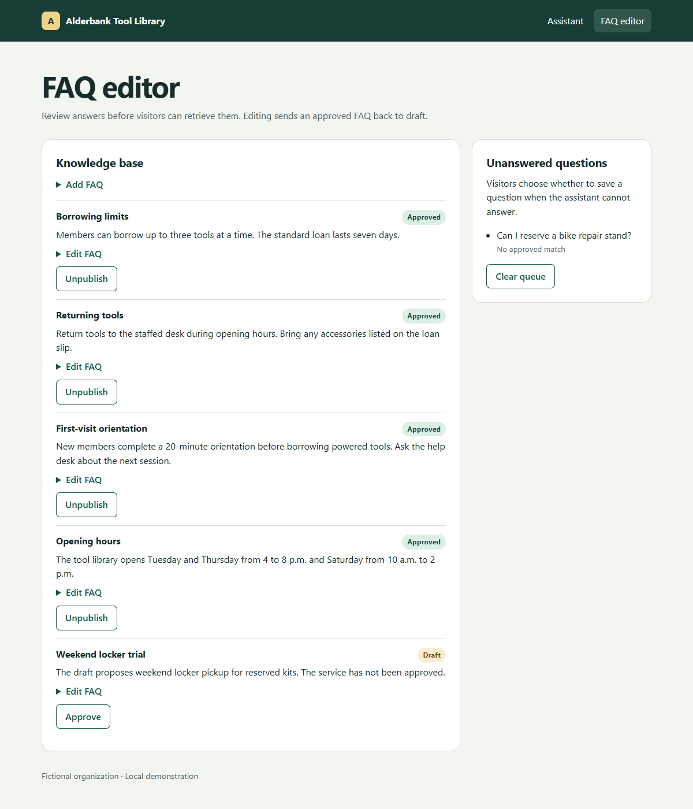

# Example conversations

| Visitor | Assistant | Evidence |
| --- | --- | --- |
| How many tools can I borrow? | Members can borrow up to three tools at a time. The standard loan lasts seven days. | Approved FAQ · Borrowing limits |
| Can I reserve a bike repair stand? | I couldn’t find an approved answer for that question. | Human support route. The unanswered queue changes only if the visitor opts in. |
| When are you open and how do I return tools? | I found more than one topic. Try asking about one topic at a time. | Ambiguous fallback |
| Can I use a weekend locker? | I couldn’t find an approved answer for that question. | The locker FAQ is a draft. |

